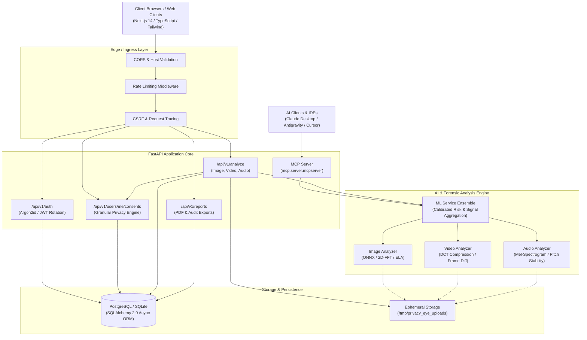

# Privacy Eye — System Architecture

This document describes the high-level system architecture, service topology, component breakdown, and runtime boundaries of the Privacy Eye platform.

---

## 1. System Overview & Component Topology

---

## 2. Layered Architecture Breakdown

### 2.1 Frontend Presentation Tier (`frontend/`)
- **Framework**: Next.js 14 (App Router) with TypeScript.
- **Styling**: Tailwind CSS with custom design tokens, dark theme, and accessible contrast.
- **State & Data Fetching**: React hooks (`useState`, `useEffect`, `useCallback`), Axios with request/response interceptors for automatic JWT bearer token attachment and refresh.
- **Key Modules**:
  - `app/dashboard/analysis/`: Real upload progress tracking (`onUploadProgress`) and genuine analysis result display.
  - `app/dashboard/live-scan/`: Real-time browser-side blink detection HUD with Eye Aspect Ratio (EAR) calculation.
  - `app/dashboard/privacy/`: Granular consent toggle center with immediate server-side persistence.
  - `app/privacy/`: Public, accessible Privacy Policy page linked across the footer, registration, and dashboard.

### 2.2 Backend Application Tier (`backend/app/`)
- **Framework**: FastAPI (Python asynchronous ASGI framework) running on Uvicorn.
- **Security & Middleware**:
  - `RequestIDMiddleware`: Generates and injects unique correlation IDs (`X-Request-ID`) into structured logs.
  - `RateLimitMiddleware`: In-memory sliding-window rate limiter per client IP.
  - `CSRFMiddleware`: Header validation for mutation requests.
- **Routing Structure**:
  - `app/api/v1/routes/auth.py`: Registration, login, token refresh, logout, session audit.
  - `app/api/v1/routes/analysis.py`: Media upload validation, consent check, inference execution, history retrieval.
  - `app/api/v1/routes/users.py`: Profile updates, granular consent management, permanent account erasure.
  - `app/api/v1/routes/reports.py`: Generation of structured JSON and PDF forensic authenticity reports.

### 2.3 Model Context Protocol (MCP) Tier (`backend/app/mcp/`)
- Exposes 8 approved Privacy Eye capabilities to external AI assistants via the official `mcp` SDK.
- Implements strict parameter validation, input length caps, and IDOR protection.

### 2.4 ML & Forensics Tier (`backend/app/ml/` & `backend/app/services/ml_service.py`)
- Employs a dual-mode hybrid architecture:
  1. **Pretrained Neural Inference**: ONNX runtime bindings when trained deepfake weight files (`.onnx`) are mounted in `backend/weights/`.
  2. **Deterministic Digital Forensics**: If neural weights are absent, executes rigorous algorithmic signal analysis (2D-FFT spectral rolloff, Error Level Analysis (ELA), DCT compression seam detection, Mel-frequency spectral centroid).
- Results include unambiguous model IDs, model versions, predictions (`AUTHENTIC`, `MANIPULATED`, `SUSPICIOUS`, `UNDETERMINED`), and documented limitations.

### 2.5 Data & Ephemeral Storage Tier (`backend/app/database/` & `file_service.py`)
- **ORM**: SQLAlchemy 2.0 with asynchronous engine (`asyncpg` for PostgreSQL, `aiosqlite` for local dev/testing).
- **Ephemeral Files**: Uploaded media resides exclusively in `/tmp/privacy_eye_uploads` during active inference and is unlinked immediately upon completion.
